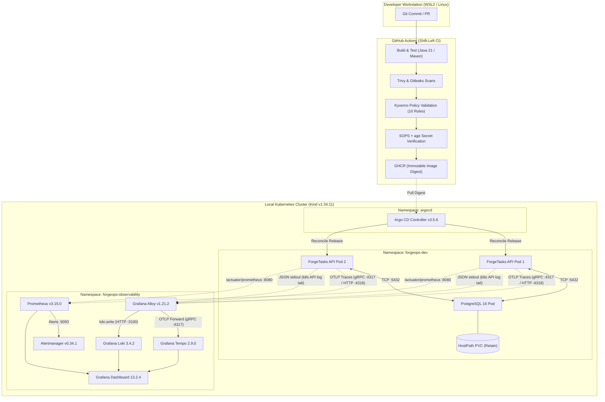

# ForgeOps — Self-Hosted DevOps & Platform Engineering Lab

[](https://adoptium.net/)
[](https://spring.io/projects/spring-boot)
[](https://www.postgresql.org/)
[](https://kind.sigs.k8s.io/)
[](https://argo-cd.readthedocs.io/)
[](https://github.com/TM-threemavithana/ForgeOps/actions/workflows/ci.yml)
[](LICENSE)

> A production-inspired, self-hosted DevOps, DevSecOps, and Platform Engineering demonstration lab built to model the full software delivery lifecycle, GitOps continuous delivery, three-pillar correlated observability, SRE chaos resilience, and automated database disaster recovery on local infrastructure with **zero paid cloud dependencies**.

---

## 1. ForgeOps Overview & The Engineering Problem

Modern cloud platforms (AWS, GCP, Azure) frequently abstract foundational systems engineering mechanics behind managed control planes, proprietary APIs, and recurring credit-card billing. When engineers only interact with managed cloud services, critical systems fundamentals—such as cgroup resource limits, container network interface (CNI) packet routing, persistent volume semantics, TLS termination, and failure domain boundaries—remain opaque.

**ForgeOps solves this** by implementing a fully reproducible, observable, and resilient software delivery platform on a local developer workstation (Windows 11 with WSL2 / Ubuntu Linux). Every operational layer—from container sandboxing to GitOps reconciliation and distributed tracing—is designed from first principles, auditable, and testable offline.

---

## 2. What the Platform Actually Does

ForgeOps hosts and manages **ForgeTasks**, a production-modeled multi-tenant task and project management REST service backed by PostgreSQL. The platform demonstrates:

* **Automated CI/CD Delivery:** GitHub Actions builds multi-architecture container images, performs static analysis, scans for CVEs/secrets (Trivy, Gitleaks), validates Kubernetes Pod security policies (Kyverno), and tags immutable digests to GitHub Container Registry (GHCR).
* **Declarative GitOps Engine:** Argo CD continuously monitors Git desired-state repositories and reconciles Helm chart releases into Kubernetes without granting CI push access to the cluster.
* **Correlated Three-Pillar Observability:** Distributed traces (OpenTelemetry Java agent -> Grafana Alloy -> Tempo), structured logs (Grafana Alloy -> Loki), and real-time metrics (Prometheus -> Alertmanager) share unified metadata, enabling one-click trace-to-log correlation in Grafana.
* **SRE Load & Chaos Resilience:** Automated k6 load generation (2,275 requests, 0.00% errors) and five controlled failure-injection experiments validate Kubernetes self-healing and rolling-update safety.
* **Automated PostgreSQL Disaster Recovery:** Deterministic point-in-time logical database backups (`pg_dump`) and non-destructive restoration to isolated disposable namespaces (`forgeops-dr-lab`) with strict exit-code error trapping.
* **Shift-Left Security & Encrypted Secrets:** 10 Kyverno Policy-as-Code rules enforce container hardening in CI; Mozilla SOPS + age provides dual-key asymmetric secret encryption directly in Git.

---

## 3. System Architecture Diagram



---

## 4. Technology Stack Grouped by Responsibility

To ensure clean system design and prevent resource collisions, ForgeOps enforces a strict **single-owner-per-resource** governance model:

| Domain | Technology | Exact Version | Lifecycle Responsibility |
|:---|:---|:---|:---|
| **Application Runtime** | Java / Spring Boot | `21 LTS / 4.1.2` | Multi-tenant REST API, Flyway schema migrations, RFC 9457 errors. |
| **Relational Database** | PostgreSQL | `16-alpine` | Relational persistence, transactional ACID integrity, foreign-key cascade. |
| **Cluster Orchestration**| Kubernetes (Kind) | `v1.34.11` (Node) | Container lifecycle, pod scheduling, service discovery, local networking. |
| **Continuous Delivery** | Argo CD | `v3.5.6` | Declarative GitOps reconciler for Helm chart manifests. |
| **Package Management** | Helm | `v3.19.5` | Manifest templating across environments (`forgeops-dev`, `staging`). |
| **Infrastructure-as-Code**| HashiCorp Terraform| `v1.10.4` | Manages local container fixtures and Argo CD bootstrap resources. |
| **Config Management** | Ansible Core | `2.17.7` | Idempotent baseline configuration and hardening of Linux hosts. |
| **Metrics & Alerting** | Prometheus & Alertmanager | `v3.15.0 / v0.34.1` | Pull-based scrape loop, SLO recording rules, multi-stage alert routing. |
| **Log Aggregation** | Grafana Loki & Alloy | `3.4.2 / v1.21.2` | Node-level daemon log shipping, JSON parsing, label indexing. |
| **Distributed Tracing** | OpenTelemetry & Tempo | `v2.1.0 / 2.9.0` | W3C context propagation, gRPC span export, trace-to-logs link. |
| **Policy-as-Code** | Kyverno CLI | `v1.19.2` | Client-side static validation of Kubernetes Pod security contexts in CI. |
| **Secret Encryption** | Mozilla SOPS + age | `v3.13.3 / v1.2.1` | Asymmetric dual-key escrow encryption for Kubernetes secrets in Git. |
| **Reliability Testing** | Grafana k6 | `v1.8.2` | Arrival-rate load generation and progressive stress scenarios. |

---

## 5. CI/CD and GitOps Delivery Flow

ForgeOps inverts the traditional imperative CI push model into a secure, pull-based GitOps architecture:

```
[Developer Push] 
       │
       ▼
[GitHub Actions CI] ─── (Static Check, Unit/Integration Tests, Kyverno, SOPS)
       │
       ▼ (Publish Container Image with Git SHA)
[GitHub Container Registry (GHCR)]
       ▲
       │ (Polls Git Manifest Repository for Desired State)
[Argo CD GitOps Engine]
       │
       ▼ (Declarative Reconciliation)
[Kubernetes Workload Rollout (RollingUpdate)]
```

* **Immutable Tagging:** Container images are tagged with exact Git commit SHAs and verified immutable digests.
* **Separation of Concerns:** GitHub Actions CI never possesses cluster credentials or SSH keys. Delivery is initiated entirely by Argo CD pulling desired state from Git.
* **Auto-Sync Guard:** In the rehearsal environment (`forgeops-gitops-rehearsal`), automated synchronization is intentionally disabled (`syncPolicy.automated.enabled: false`) to mandate operator review prior to applying state changes.

---

## 6. Kubernetes Security & Supply-Chain Controls

* **Non-Root & Hardened Pods:** Application pods run strictly under UID `10001` (`appuser`), with `allowPrivilegeEscalation: false`, `readOnlyRootFilesystem: true`, and all Linux capabilities dropped (`drop: ["ALL"]`).
* **Policy-as-Code (Kyverno):** 10 security policies audit 100% of Helm-rendered Pod templates in CI against core container security best practices (disallowing root, privilege escalation, host namespaces, and enforcing read-only root filesystems).
* **Supply-Chain Integrity:** Downloaded binaries in CI (Kyverno, SOPS, age) are verified against authentic SHA-256 release checksums, failing closed on binary tampering. Release digests are verified to prevent executing OCI attestation manifests.
* **Encrypted Secrets (SOPS + age):** Secrets are committed to Git in encrypted format using a dual-recipient scheme (`Primary Operational Key` + `Recovery Escrow Key`). The regex `^(data|stringData)$` leaves metadata readable for linters while securing sensitive payloads.

---

## 7. Metrics, Logs, and Traces Integration

ForgeOps achieves unified three-pillar observability across the microservice and infrastructure:

1. **Distributed Tracing:** The OpenTelemetry Java instrumentation agent intercepts HTTP requests, generates a W3C trace context, and attaches `trace_id` and `span_id` to the logging context (MDC).
2. **Alloy OTLP Pipeline:** Traces are sent to Grafana Alloy's OTLP receiver (`otelcol.receiver.otlp`) on ports 4317/4318, which forwards them directly to Grafana Tempo.
3. **Structured Logging:** Grafana Alloy tails container logs from the Kubernetes API, extracts low-cardinality labels, and ships them to Loki.
4. **Trace-to-Logs Correlation:** Inside Grafana (`http://localhost:3000`), viewing a trace in Tempo displays a direct button to query Loki for that exact `trace_id`, pinpointing logs without manual querying.
5. **Alerting Pipeline:** Prometheus monitors HTTP latency, error rates, and connection pool saturation, routing firing states through Alertmanager.

---

## 8. SRE Reliability and Disaster Recovery Results

### 8.1 Progressive k6 Load Testing Summary (Gate G12)
All scenarios were executed sequentially against `http://127.0.0.1:8082` (port-forwarded to `sre-api` service in `forgeops-sre-lab`):

| Scenario | Target Profile | Total Requests | Error Rate | Latency p50 | Latency p95 | Latency p99 | Max Latency |
|:---|:---|:---|:---|:---|:---|:---|:---|
| **Smoke** | 2 req/s constant (20s) | 41 | **0.00%** | 7.98 ms | 10.72 ms | 34.56 ms | 35.03 ms |
| **Baseline**| 10 req/s constant (45s) | 450 | **0.00%** | 5.31 ms | 7.50 ms | 9.37 ms | 25.86 ms |
| **Ramp-Up** | 2 -> 10 -> 18 req/s (70s) | 672 | **0.00%** | 4.26 ms | 6.37 ms | 28.87 ms | 32.89 ms |
| **Stress** | 5 -> 15 -> 20 req/s ceiling (80s)| 1,052 | **0.00%** | 3.51 ms | 5.20 ms | 27.00 ms | 33.80 ms |
| **Recovery**| 2 req/s constant (30s) | 60 | **0.00%** | 3.47 ms | 5.33 ms | 9.76 ms | 10.02 ms |
| **TOTAL** | *Full Suite (Sequential)* | **2,275** | **0.00%** | **4.21 ms** | **6.82 ms** | **28.10 ms** | **35.03 ms** |

*Note: Testing used a single-backend `kubectl port-forward` connection, reflecting single-pod saturation characteristics rather than round-robin load balancer distribution.*

### 8.2 Controlled Resilience Experiments (Gate G12)
1. **Experiment 01: Stateless Pod Termination:** Deleted victim pod under load; replacement pod scheduled and verified ready in **52.86 seconds** (TTD: 1.69s) with zero dropped connections.
2. **Experiment 02: Readiness Probe Failure Injection:** Patched readiness probe to invalid URL; unready surge pod excluded from Service endpoints; restored via rollout undo in **706 ms**.
3. **Experiment 03: Invalid Image Rollout Guard:** Deployed nonexistent image tag `1.0.0-g12-invalid`; deployment stalled in `ErrImagePull` while existing replicas served traffic; recovered via rollout undo in **813 ms**.
4. **Experiment 04: Bounded Resource Pressure:** Subjected service to 1,052 requests up to 10 VUs / 20 req/s ceiling; 0 OOMKills, 0 container restarts.
5. **Experiment 05: Declarative Drift Reconciliation:** Scaled deployment imperatively to 3 replicas; declarative `kubectl apply -k platform/sre-lab` converged state back to 2 replicas in **1.47 seconds**.

### 8.3 PostgreSQL Disaster Recovery Results (Gate G13)
* **Backup Method:** Discrete point-in-time logical backup via `pg_dump -Fc` with SHA-256 checksum verification (not continuous streaming PITR).
* **`pg_dump` Duration:** **273 ms**.
* **`pg_restore` Duration:** **252 ms** (executed with strict `--exit-on-error` into fresh disposable target `forgeops-dr-lab`).
* **End-to-End Service RTO:** **89.29 seconds** (total elapsed time: drill trigger, disposable DB provisioning, schema restore, API boot, and BCrypt account authentication).
* **Drill Backup Age:** **12.00 seconds** (currency of the test snapshot when restored during the rehearsal drill).
* **Baseline Storage Preservation:** All 5 baseline PVCs preserved with identical UIDs throughout all tests.

---

## 9. Getting Started with Docker Compose (Inner Loop)

For rapid local development of the application and PostgreSQL without Kubernetes:

### Prerequisites
- Docker Engine & Docker Compose (`v27.x+`)
- Java 21 LTS & Maven 3.9+ (optional if using wrapper)

```bash
# 1. Clone repository
git clone https://github.com/TM-threemavithana/ForgeOps.git
cd ForgeOps

# 2. Start PostgreSQL and application via Docker Compose
docker compose up -d

# 3. Verify health probes
curl -s http://127.0.0.1:18080/actuator/health/readiness | jq .

# 4. Tear down environment
docker compose down
```

---

## 10. Kubernetes and Advanced Environment Overview

For full platform validation (Kubernetes, Argo CD, Observability, DR):

```bash
# Verify environment readiness
make doctor

# Inspect running cluster pods
kubectl get pods -A

# Forward Grafana to inspect metrics, logs, and traces
kubectl port-forward svc/g09-monitoring-grafana -n forgeops-observability 3000:80
# Visit http://localhost:3000
# Note: Grafana admin password is managed via cluster secrets (inspect with kubectl get secret)

# Forward Argo CD UI
kubectl port-forward svc/argocd-server -n argocd 8080:443
# Visit https://localhost:8080
# Note: Argo CD initial admin secret is stored in secret/argocd-initial-admin-secret
```

---

## 11. Evidence-Backed Results with Direct Links

Every capability claimed in ForgeOps is substantiated by actual execution logs:

* **[Requirements Traceability Matrix](docs/audit/REQUIREMENTS_TRACEABILITY_MATRIX.md):** Complete audit of requirements G00 through G15.
* **[Final Security & Operational Review](docs/audit/FINAL_SECURITY_AND_OPERATIONAL_REVIEW.md):** Deep audit of CI trust boundaries, RBAC, and container sandboxing.
* **[Reproducibility Audit](docs/audit/REPRODUCIBILITY_AUDIT.md):** Clean machine walkthrough guide and hardware profiles.
* **[Gate G12 SRE Evidence](docs/evidence/G12/G12-acceptance-report.md):** k6 load outputs, chaos test records, and recovery measurements.
* **[Gate G13 DR Evidence](docs/evidence/G13/G13-acceptance-report.md):** PostgreSQL backup manifests, restore logs, and synthetic user verification.
* **[Gate G14 Security Evidence](docs/evidence/G14/G14-acceptance-report.md):** Kyverno policy test passes and SOPS dual-key decryption proof.

---

## 12. Security Limitations and Known Trade-Offs

In accordance with our honesty invariant, the following limitations are documented:
1. **Single-Node Infrastructure:** Runs on Kind in Docker; cannot model physical multi-datacenter network partitions or hardware hypervisor failures.
2. **Kindnet CNI:** Default CNI handles routing but does not enforce kernel-level `NetworkPolicy` packet drops. Manifests exist as architectural specifications.
3. **Client-Side Kyverno:** Policies run via CLI in CI. While 100% of merged manifests are compliant, in-cluster mutating webhooks are omitted to avoid local cluster deadlocks.
4. **Offline Secret Custody:** Age private keys are managed offline by operators rather than an external cloud HSM/Vault.
5. **Logical Database Backups:** DR relies on discrete `pg_dump` snapshots. Continuous WAL streaming and PITR are deferred due to cloud storage requirements.
*See [KNOWN_LIMITATIONS.md](docs/portfolio/KNOWN_LIMITATIONS.md) for full architectural trade-off details.*

---

## 13. Detailed Documentation and Runbooks

* **[Incident Response Master Runbook](docs/runbooks/INCIDENT_RESPONSE_MASTER_RUNBOOK.md)**
* **[PostgreSQL Disaster Recovery Runbook](docs/runbooks/POSTGRESQL_DISASTER_RECOVERY_RUNBOOK.md)**
* **[SOPS + age Secret Management Runbook](docs/runbooks/SOPS_AGE_SECRET_MANAGEMENT_RUNBOOK.md)**
* **[API CrashLoopBackOff Runbook](docs/runbooks/RUNBOOK_API_CRASH_LOOP.md)**
* **[High Latency & Saturation Runbook](docs/runbooks/RUNBOOK_HIGH_LATENCY_AND_SATURATION.md)**
* **[Image Rollout Failure Runbook](docs/runbooks/RUNBOOK_IMAGE_ROLLOUT_FAILURE.md)**

---

## 14. Demo and Portfolio Links

* **[Executive Summary & Project Overview](docs/portfolio/PROJECT_OVERVIEW.md)**
* **[Architecture Walkthrough & Design Decisions](docs/portfolio/ARCHITECTURE_WALKTHROUGH.md)**
* **[3-5 Minute Technical Demo Script](docs/portfolio/DEMO_SCRIPT.md)**
* **[Tailored Resume Bullet Points (SRE / Platform / DevOps)](docs/portfolio/RESUME_BULLETS.md)**
* **[22 Technical Interview Questions & Answers](docs/portfolio/INTERVIEW_QA.md)**
* **[Engineering Lessons Learned & RCA Postmortems](docs/portfolio/ENGINEERING_LESSONS.md)**
* **[Architecture Diagrams (Mermaid Visuals)](docs/architecture/ARCHITECTURE_DIAGRAMS.md)**
