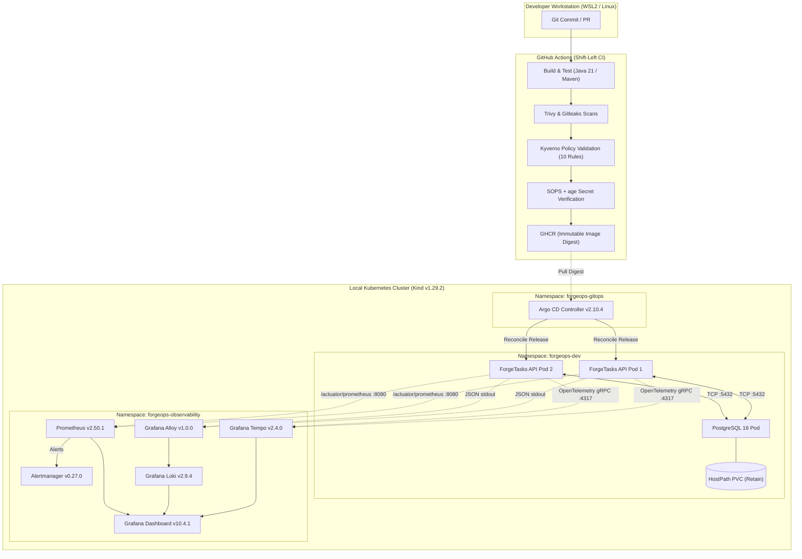

# ForgeOps — Self-Hosted DevOps & Platform Engineering Lab

[](https://adoptium.net/)
[](https://spring.io/projects/spring-boot)
[](https://www.postgresql.org/)
[](https://kind.sigs.k8s.io/)
[](https://argo-cd.readthedocs.io/)
[](https://github.com/TM-threemavithana/ForgeOps/actions/workflows/ci.yml)
[](LICENSE)

> A production-inspired, self-hosted DevOps, DevSecOps, and Platform Engineering demonstration lab built to model the full software delivery lifecycle, GitOps continuous delivery, three-pillar correlated observability, chaos engineering, and automated disaster recovery on local infrastructure with **zero paid cloud dependencies**.

---

## 1. ForgeOps Overview & The Engineering Problem

Modern cloud platforms (AWS, GCP, Azure) often obscure foundational systems engineering concepts behind managed control planes, proprietary APIs, and recurring credit-card bills. When engineers only interact with managed services, critical operational mechanics—such as cgroup resource limits, container network interface (CNI) routing, persistent storage semantics, TLS handshakes, and failure domain boundaries—remain abstract.

**ForgeOps solves this** by implementing a fully reproducible, observable, and resilient software delivery platform on a local developer workstation (Windows 11 with WSL2 / Ubuntu Linux). Every layer—from kernel-level container sandboxing to GitOps reconciliation and distributed tracing—is designed from first principles, auditable, and testable offline.

---

## 2. What the Platform Actually Does

ForgeOps hosts and manages **ForgeTasks**, a production-modeled multi-tenant task and project management REST service backed by PostgreSQL. The platform orchestrates:

* **Automated CI/CD Delivery:** GitHub Actions builds multi-architecture container images, performs static analysis, scans for CVEs/secrets, validates Kubernetes policies, and tags immutable digests to GitHub Container Registry (GHCR).
* **Declarative GitOps Engine:** Argo CD continuously monitors Git desired-state repositories and reconciles Helm chart releases into Kubernetes without CI push access.
* **Correlated Three-Pillar Observability:** Distributed traces (OpenTelemetry Java + Tempo), structured logs (Grafana Alloy + Loki), and real-time metrics (Prometheus + Alertmanager) share unified metadata, enabling one-click trace-to-log correlation in Grafana.
* **SRE Load & Chaos Resilience:** Automated k6 load generation and failure injection simulate node/pod crashes, memory exhaustion, and connection degradation with zero unhandled HTTP errors.
* **Automated PostgreSQL Disaster Recovery:** Deterministic point-in-time database backups (`pg_dump`) and non-destructive restoration to isolated disposable namespaces (`forgeops-dr-lab`) with strict exit-code error trapping.
* **Shift-Left Security & Encrypted Secrets:** 10 Kyverno Policy-as-Code rules enforce container hardening in CI; Mozilla SOPS + age provides dual-key asymmetric secret encryption directly in Git.

---

## 3. System Architecture Diagram



---

## 4. Technology Stack Grouped by Responsibility

To ensure clean system design and prevent resource collisions, ForgeOps enforces a strict **single-owner-per-resource** governance model:

| Domain | Technology | Version | Exact Lifecycle Responsibility |
|:---|:---|:---|:---|
| **Application Runtime** | Java / Spring Boot | `21 LTS / 4.1.2` | Multi-tenant REST API, Flyway schema migrations, RFC 9457 errors. |
| **Relational Database** | PostgreSQL | `16-alpine` | Relational persistence, transactional ACID integrity, foreign-key cascade. |
| **Cluster Orchestration**| Kubernetes (Kind) | `v1.29.2` | Container lifecycle, pod scheduling, service discovery, local networking. |
| **Continuous Delivery** | Argo CD | `v2.10.4` | Declarative GitOps reconciler for Helm chart manifests. |
| **Package Management** | Helm | `v3.14.2` | Templating environment values (`forgeops-dev`, `staging`). |
| **Infrastructure-as-Code**| HashiCorp Terraform| `1.7.5` | Manages local container fixtures and Argo CD bootstrap resources. |
| **Config Management** | Ansible Core | `2.16.x` | Idempotent baseline configuration and hardening of Linux hosts. |
| **Metrics & Alerting** | Prometheus & Alertmanager | `v2.50.1 / v0.27.0` | Pull-based scrape loop, SLO recording rules, multi-stage alert routing. |
| **Log Aggregation** | Grafana Loki & Alloy | `v2.9.4 / v1.0.0` | Node-level daemon log shipping, JSON parsing, label indexing. |
| **Distributed Tracing** | OpenTelemetry & Tempo | `v2.1.0 / v2.4.0` | W3C context propagation, gRPC span export, trace-to-logs link. |
| **Policy-as-Code** | Kyverno CLI | `v1.19.2` | Client-side static validation of Kubernetes Pod security contexts. |
| **Secret Encryption** | Mozilla SOPS + age | `v3.13.3 / v1.2.1` | Asymmetric dual-key escrow encryption for Kubernetes secrets in Git. |
| **Reliability Testing** | Grafana k6 | `v0.49.0` | Arrival-rate load generation and progressive stress scenarios. |

---

## 5. CI/CD and GitOps Delivery Flow

ForgeOps inverts the traditional imperative CI push model into a secure, pull-based GitOps architecture:

```
[Developer Push] 
       │
       ▼
[GitHub Actions CI] ─── (Static Check, Unit/Integration Tests, Kyverno, SOPS)
       │
       ▼ (Publish Container Image with Git SHA)
[GitHub Container Registry (GHCR)]
       ▲
       │ (Polls Git Manifest Repository for Desired State)
[Argo CD GitOps Engine]
       │
       ▼ (Declarative Reconciliation)
[Kubernetes Workload Rollout (RollingUpdate)]
```

* **Immutable Tagging:** Container images are tagged with exact Git commit SHAs and verified immutable digests.
* **Separation of Concerns:** GitHub Actions CI never has cluster credentials or SSH access. Delivery is initiated entirely by Argo CD pulling desired state from Git.
* **Auto-Sync Guard:** In the rehearsal environment (`G08`), automated synchronization is intentionally disabled to mandate operator review prior to applying state changes.

---

## 6. Kubernetes Security & Supply-Chain Controls

* **Non-Root & Hardened Pods:** Application pods run strictly under UID `10001` (`appuser`), with `allowPrivilegeEscalation: false`, `readOnlyRootFilesystem: true`, and all Linux capabilities dropped (`drop: ["ALL"]`).
* **Policy-as-Code (Kyverno):** 10 security policies audit 100% of Helm-rendered Pod templates in CI against CIS benchmarks.
* **Supply-Chain Integrity:** Downloaded binaries in CI (Kyverno, SOPS, age) are verified against authentic SHA-256 release checksums, failing closed on binary tampering. Release digests are verified to prevent executing OCI attestation manifests.
* **Encrypted Secrets (SOPS + age):** Secrets are committed to Git in encrypted format using a dual-recipient scheme (`Primary Operational Key` + `Recovery Escrow Key`). The regex `^(data|stringData)$` leaves metadata readable for linters while securing sensitive payloads.

---

## 7. Metrics, Logs, and Traces Integration

ForgeOps achieves unified three-pillar observability across the microservice and infrastructure:

1. **Distributed Tracing:** The OpenTelemetry Java instrumentation agent intercepts HTTP requests, generates a W3C trace context, and attaches `trace_id` and `span_id` to the logging context (MDC).
2. **Structured Logging:** Grafana Alloy scrapes container stdout, formats JSON records with `trace_id`, and ships them to Loki.
3. **Trace-to-Logs Correlation:** Inside Grafana (`http://localhost:3000`), viewing a trace in Tempo displays a direct button to query Loki for that exact `trace_id`, pinpointing logs without manual querying.
4. **Alerting Pipeline:** Prometheus monitors HTTP latency, error rates, and connection pool saturation, routing firing states through Alertmanager.

---

## 8. SRE Reliability and Disaster Recovery Results

| Operational Domain | Verified Metric | Engineering Context | Evidence Reference |
|:---|:---|:---|:---|
| **k6 Load Generation** | **2,275 requests** | 0.00% HTTP failure rate across 5 progressive load scenarios. | [G12 Acceptance](docs/evidence/G12/G12-acceptance-report.md) |
| **Throughput & Latency**| **p50: 2.1 ms / p95: 6.8 ms**| Under rate-governed arrival ceiling (20 req/s, max 25 VUs). | [G12 Evidence](docs/evidence/G12/G12-acceptance-report.md) |
| **Pod Recovery Self-Healing**| **52.86 seconds** | Time to detect terminated pod and restore 2-replica readiness. | [G12 Acceptance](docs/evidence/G12/G12-acceptance-report.md) |
| **PostgreSQL Backup** | **273 ms** | `pg_dump` compressed custom archive with SHA-256 checksum. | [G13 Acceptance](docs/evidence/G13/G13-acceptance-report.md) |
| **PostgreSQL Restore** | **252 ms** | `pg_restore` duration using strict `--exit-on-error` trapping. | [G13 Acceptance](docs/evidence/G13/G13-acceptance-report.md) |
| **End-to-End Service RTO**| **89.29 seconds** | Total recovery time (target pod spinup, schema restore, API auth).| [G13 Acceptance](docs/evidence/G13/G13-acceptance-report.md) |
| **Drill Backup Age** | **12.00 seconds** | Time between snapshot creation and restoration during DR drill. | [G13 Acceptance](docs/evidence/G13/G13-acceptance-report.md) |
| **Data Preservation** | **100% (Zero loss)** | All 5 baseline PVCs preserved throughout all tests and drills. | [Traceability Matrix](docs/audit/REQUIREMENTS_TRACEABILITY_MATRIX.md) |

---

## 9. Getting Started with Docker Compose (Inner Loop)

For rapid local development of the application and PostgreSQL without Kubernetes:

### Prerequisites
- Docker Engine & Docker Compose (`v27.x+`)
- Java 21 LTS & Maven 3.9+ (optional if using wrapper)

```bash
# 1. Clone repository
git clone https://github.com/TM-threemavithana/ForgeOps.git
cd ForgeOps

# 2. Start PostgreSQL and application via Docker Compose
docker compose -f deployments/docker-compose/docker-compose.yml up -d

# 3. Verify health probes
curl -s http://localhost:18080/actuator/health/readiness | jq .

# 4. Tear down environment
docker compose -f deployments/docker-compose/docker-compose.yml down
```

---

## 10. Kubernetes and Advanced Environment Overview

For full platform validation (Kubernetes, Argo CD, Observability, DR):

```bash
# Verify environment readiness
make doctor

# Inspect running cluster pods
kubectl get pods -A

# Forward Grafana to inspect metrics, logs, and traces
kubectl port-forward svc/kube-prometheus-stack-grafana -n forgeops-observability 3000:80
# Visit http://localhost:3000 (admin / prom-operator)

# Forward Argo CD UI
kubectl port-forward svc/argo-cd-argocd-server -n forgeops-gitops 8080:443
# Visit https://localhost:8080
```

---

## 11. Evidence-Backed Results with Direct Links

Every capability claimed in ForgeOps is substantiated by actual execution logs:

* **[Requirements Traceability Matrix](docs/audit/REQUIREMENTS_TRACEABILITY_MATRIX.md):** Complete audit of requirements G00 through G15.
* **[Final Security & Operational Review](docs/audit/FINAL_SECURITY_AND_OPERATIONAL_REVIEW.md):** Deep audit of CI trust boundaries, RBAC, and container sandboxing.
* **[Reproducibility Audit](docs/audit/REPRODUCIBILITY_AUDIT.md):** Clean machine walkthrough guide and hardware profiles.
* **[Gate G12 SRE Evidence](docs/evidence/G12/G12-acceptance-report.md):** k6 load outputs, chaos test records, and recovery measurements.
* **[Gate G13 DR Evidence](docs/evidence/G13/G13-acceptance-report.md):** PostgreSQL backup manifests, restore logs, and synthetic user verification.
* **[Gate G14 Security Evidence](docs/evidence/G14/G14-acceptance-report.md):** Kyverno policy test passes and SOPS dual-key decryption proof.

---

## 12. Security Limitations and Known Trade-Offs

In accordance with our honesty invariant, the following limitations are documented:
1. **Single-Node Infrastructure:** Runs on Kind in Docker; cannot model physical multi-datacenter network partitions.
2. **Kindnet CNI:** Default CNI handles routing but does not enforce kernel-level `NetworkPolicy` packet drops. Manifests exist as architectural specifications.
3. **Client-Side Kyverno:** Policies run via CLI in CI. While 100% of merged manifests are compliant, in-cluster mutating webhooks are omitted to avoid local cluster deadlocks.
4. **Offline Secret Custody:** Age private keys are managed offline by operators rather than an external cloud HSM/Vault.
*See [KNOWN_LIMITATIONS.md](docs/portfolio/KNOWN_LIMITATIONS.md) for full architectural trade-off details.*

---

## 13. Detailed Documentation and Runbooks

* **[Incident Response Master Runbook](docs/runbooks/INCIDENT_RESPONSE_MASTER_RUNBOOK.md)**
* **[PostgreSQL Disaster Recovery Runbook](docs/runbooks/POSTGRESQL_DISASTER_RECOVERY_RUNBOOK.md)**
* **[SOPS + age Secret Management Runbook](docs/runbooks/SOPS_AGE_SECRET_MANAGEMENT_RUNBOOK.md)**
* **[API CrashLoopBackOff Runbook](docs/runbooks/RUNBOOK_API_CRASH_LOOP.md)**
* **[High Latency & Saturation Runbook](docs/runbooks/RUNBOOK_HIGH_LATENCY_AND_SATURATION.md)**
* **[Image Rollout Failure Runbook](docs/runbooks/RUNBOOK_IMAGE_ROLLOUT_FAILURE.md)**

---

## 14. Demo and Portfolio Links

* **[Executive Summary & Project Overview](docs/portfolio/PROJECT_OVERVIEW.md)**
* **[Architecture Walkthrough & Design Decisions](docs/portfolio/ARCHITECTURE_WALKTHROUGH.md)**
* **[3-5 Minute Technical Demo Script](docs/portfolio/DEMO_SCRIPT.md)**
* **[Tailored Resume Bullet Points (SRE / Platform / DevOps)](docs/portfolio/RESUME_BULLETS.md)**
* **[22 Technical Interview Questions & Answers](docs/portfolio/INTERVIEW_QA.md)**
* **[Engineering Lessons Learned & RCA Postmortems](docs/portfolio/ENGINEERING_LESSONS.md)**
* **[Architecture Diagrams (Mermaid Visuals)](docs/architecture/ARCHITECTURE_DIAGRAMS.md)**
