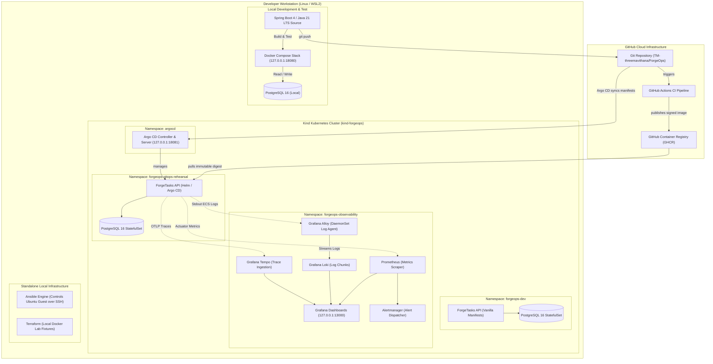
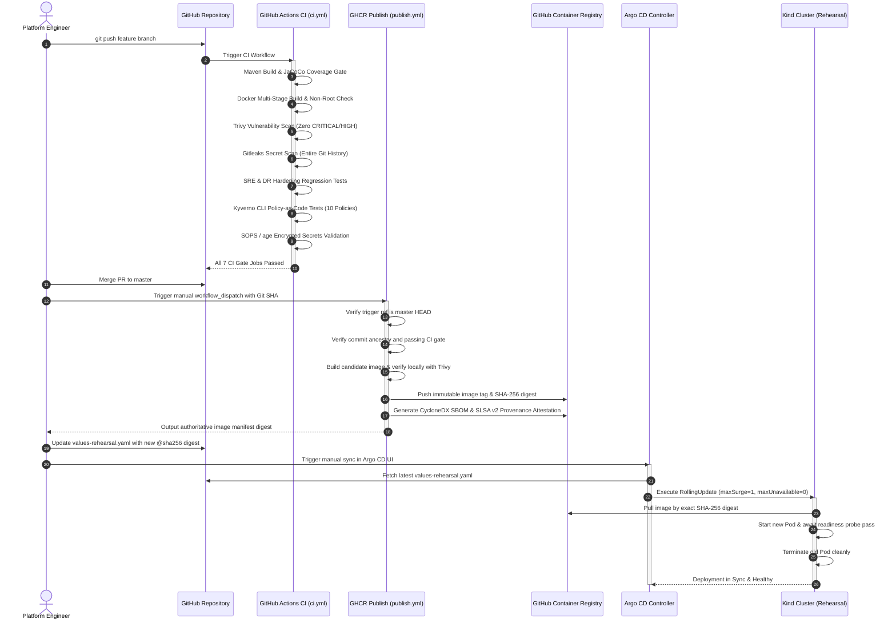
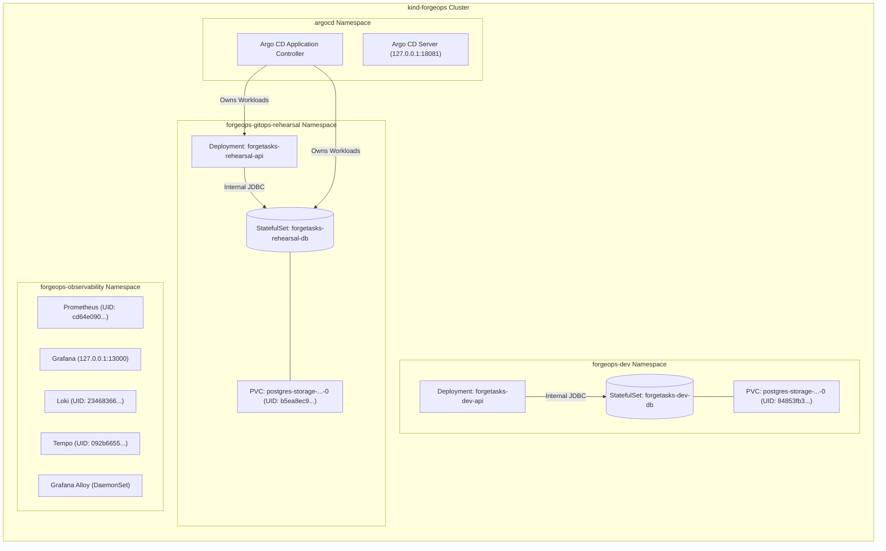
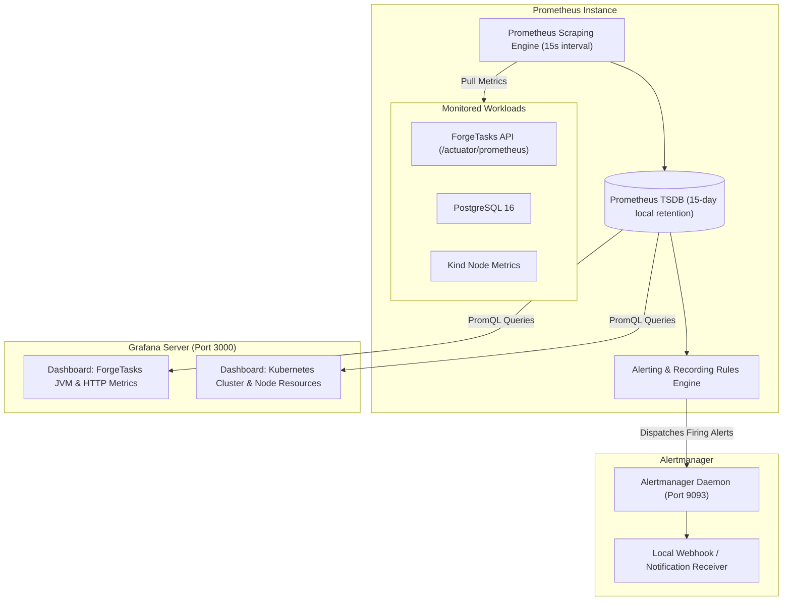
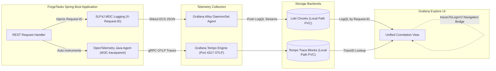
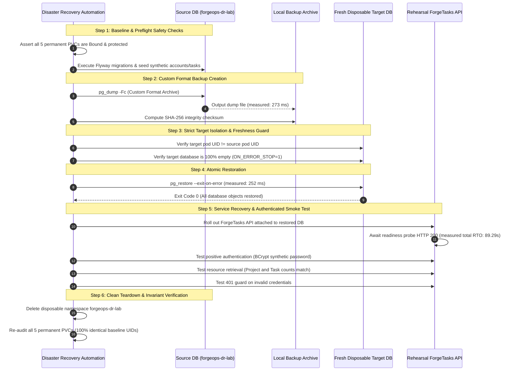
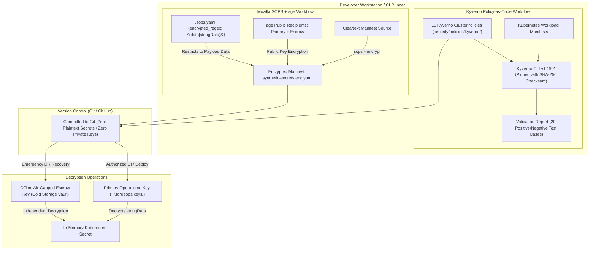

# ForgeOps Visual Architecture & System Flow Diagrams

This document contains GitHub-compatible Mermaid diagrams illustrating the architectural components, delivery pipelines, observability telemetry, disaster recovery flows, and security boundaries across the ForgeOps platform.

---

## 1. End-to-End ForgeOps Platform Architecture

---

## 2. GitHub Actions to GHCR to Argo CD Delivery Pipeline

---

## 3. Kubernetes Workload and Namespace Ownership

---

## 4. Prometheus & Grafana Monitoring Flow

---

## 5. Grafana Alloy, Loki, and Tempo Unified Telemetry Flow

---

## 6. G13 PostgreSQL Backup & Disposable Lab Recovery Flow

---

## 7. G14 Kyverno Policy-as-Code & SOPS Encrypted Secret Lifecycle

