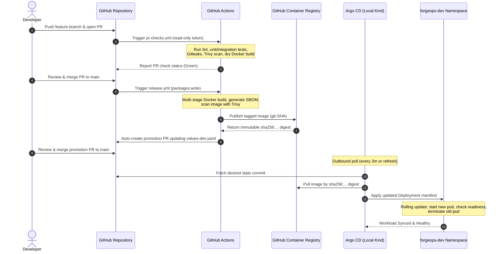
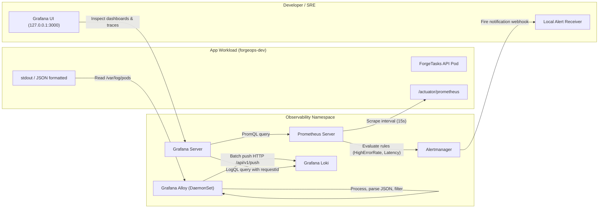
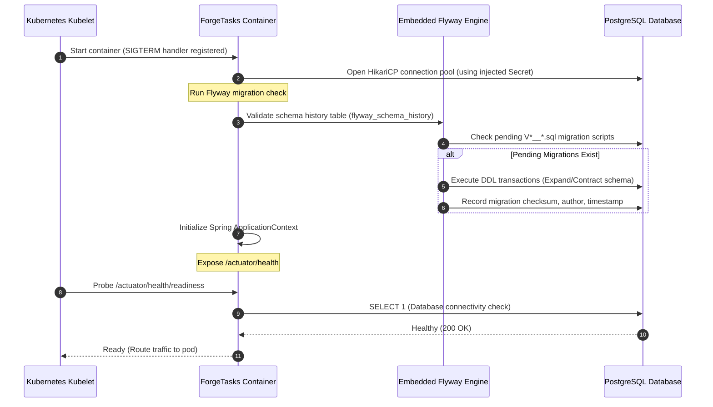
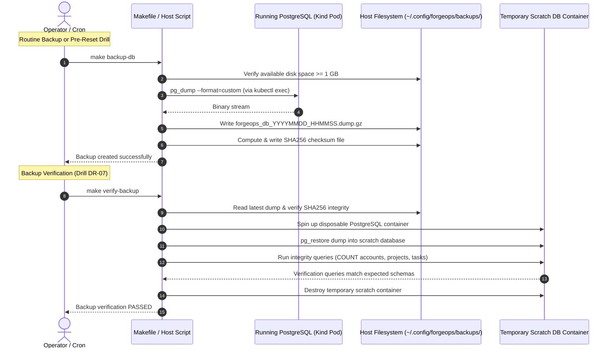

# End-to-End Data & Promotion Flows — ForgeOps

**Document Version:** 1.0  
**Effective Date:** 2026-10-22  
**Baseline Gate:** G00 Architecture Review

---

## 1. Continuous Delivery & GitOps Promotion Flow

The software delivery lifecycle follows an immutable, pull-based GitOps pipeline. No hosted runner ever reaches into the local laptop.



---

## 2. Observability & Telemetry Signal Flow

Observability signals are segregated into metrics, alerts, and structured logs, correlated by common dimensional labels and request IDs.



### Telemetry Correlation Contract:
1. Every incoming HTTP request is assigned a unique `requestId` (UUID) via an HTTP filter.
2. The `requestId` is injected into the SLF4J MDC (Mapped Diagnostic Context) and appended to all structured JSON application log lines.
3. Errors returned to the client (RFC 7807) include the exact same `requestId`.
4. An operator triaging a 5xx spike in Grafana can copy the `requestId` from the HTTP response and immediately retrieve the matching stack trace from Loki via LogQL:
   ```logql
   {namespace="forgeops-dev", app="forgetasks"} |= "550e8400-e29b-41d4-a716-446655440000"
   ```

---

## 3. Database Migration & Lifecycle Flow

PostgreSQL schema state evolves strictly through Flyway relational migrations executed during application startup.



---

## 4. Disaster Recovery & Backup Flow

Host-side database backups protect state against accidental Kind cluster destruction.


