# Network Topology & Port Allocation — ForgeOps

**Document Version:** 1.0  
**Effective Date:** 2026-10-22  
**Baseline Gate:** G00 Architecture Review

---

## 1. Network Topology & Segments

ForgeOps defines five distinct, isolated network zones. Network boundaries are enforced through local interface bindings, Docker bridge networks, Kubernetes CNI policies, and SSH access controls.

```mermaid
flowchart TD
    subgraph PublicInternet ["Zone 0: Public Internet / GitHub SaaS"]
        GH_API["GitHub API / Raw Content"]
        GHCR_REG["GitHub Container Registry (ghcr.io)"]
    end

    subgraph HostLoopback ["Zone 1: Host Loopback (127.0.0.1 Only)"]
        Browser["Operator Web Browser / curl"]
        CLI["Host CLI / IDE (VSCode / Antigravity)"]
    end

    subgraph DockerBridge ["Zone 2: Local Docker Networks"]
        ComposeNet["docker-compose default network"]
        TF_Net["forgeops-iac-lab network (Terraform owned)"]
    end

    subgraph KindNetwork ["Zone 3: Kind Cluster Virtual Network"]
        KindBridge["kind bridge (docker0 / br-kind)"]
        
        subgraph PodCIDR ["Pod Network (10.244.0.0/16)"]
            DevPods["forgeops-dev Pods (10.244.1.x)"]
            StagingPods["forgeops-staging Pods (10.244.2.x)"]
            ObsPods["observability Pods (10.244.3.x)"]
            ArgoPods["argocd Pods (10.244.0.x)"]
        end

        subgraph SvcCIDR ["Service Network (10.96.0.0/12)"]
            KubeDNS["kube-dns (10.96.0.10)"]
            DevSvc["forgetasks-api-dev Svc"]
            DBSvc["forgetasks-db-dev Svc"]
            PromSvc["prometheus-operated Svc"]
        end
    end

    subgraph VMLabNet ["Zone 4: Isolated Ansible Lab Network (Host-Only / Restricted NAT)"]
        VM_SSH["Ubuntu Guest SSH (Port 2222 or 192.168.56.x:22)"]
        VM_Nginx["Guest Nginx Web Service (Port 8080)"]
    end

    %% Network flows
    CLI -->|"kubectl port-forward --address 127.0.0.1"| KindBridge
    Browser -->|"http://127.0.0.1:8080"| DevSvc
    Browser -->|"http://127.0.0.1:3000"| ObsPods
    Browser -->|"http://127.0.0.1:8081"| ArgoPods

    CLI -->|"docker compose up"| ComposeNet
    CLI -->|"terraform apply"| TF_Net

    CLI -->|"ssh -i lab_key -p 2222 ops@127.0.0.1"| VM_SSH

    ArgoPods -->|"Outbound HTTPS (TCP 443)"| GH_API
    KindBridge -->|"Outbound HTTPS (TCP 443)"| GHCR_REG

    %% Prohibited flows
    DevPods -.-x|"BLOCKED by NetworkPolicy"| StagingPods
    DevPods -->|"Allowed (Port 5432)"| DBSvc
    DevPods -->|"DNS Lookup (Port 53)"| KubeDNS
```

---

## 2. Port Allocation Table

All local endpoints must bind strictly to the loopback interface (`127.0.0.1`). Binding to wildcard (`0.0.0.0`) is prohibited to prevent exposure across local Wi-Fi or LAN subnets.

| Subsystem | Service Name | Protocol | Container / Internal Port | Host Loopback Port | Access Mechanism |
|---|---|---|---|---|---|
| **Docker Compose** | `forgetasks-api` | HTTP | 8080 | `127.0.0.1:8080` | Direct Compose port mapping |
| **Docker Compose** | `postgres` | TCP | 5432 | `127.0.0.1:5432` | Direct Compose port mapping |
| **Kind Dev** | `forgetasks-api` | HTTP | 8080 | `127.0.0.1:8080` | `kubectl port-forward -n forgeops-dev` |
| **Kind Dev** | `forgetasks-db` | TCP | 5432 | `127.0.0.1:5433` | `kubectl port-forward -n forgeops-dev` |
| **Kind Staging** | `forgetasks-api` | HTTP | 8080 | `127.0.0.1:8090` | `kubectl port-forward -n forgeops-staging` |
| **Kind Staging** | `forgetasks-db` | TCP | 5432 | `127.0.0.1:5434` | `kubectl port-forward -n forgeops-staging` |
| **Argo CD** | `argocd-server` | HTTPS | 8080 | `127.0.0.1:8081` | `kubectl port-forward -n argocd` |
| **Observability** | `grafana` | HTTP | 3000 | `127.0.0.1:3000` | `kubectl port-forward -n observability` |
| **Observability** | `prometheus` | HTTP | 9090 | `127.0.0.1:9090` | `kubectl port-forward -n observability` |
| **Observability** | `alertmanager` | HTTP | 9093 | `127.0.0.1:9093` | `kubectl port-forward -n observability` |
| **Observability** | `loki` | HTTP | 3100 | Cluster Internal | Scraped internally by Grafana / Alloy |
| **Ansible VM** | `sshd` (Guest) | SSH | 22 | `127.0.0.1:2222` | Host port forward / Host-only adapter |
| **Ansible VM** | `nginx` (Guest)| HTTP | 80 | `127.0.0.1:8088` | Host port forward / Host-only adapter |
| **Terraform Lab** | `diag-fixture` | HTTP | 80 | `127.0.0.1:8089` | Terraform docker container port |

---

## 3. Firewall & Traffic Rules

### 3.1 Host Inbound Rules (Windows Firewall)
- **Default Policy:** Deny all inbound unsolicited connections from external network interfaces (`Wi-Fi`, `Ethernet`).
- **Loopback Allow:** Allow all inbound connections originating from `127.0.0.1` and `::1`.
- **Prohibition:** Operators shall never run `netsh advfirewall set allprofiles state off` or create blanket inbound allow rules to troubleshoot lab connectivity.

### 3.2 Guest Inbound Rules (Ansible UFW Firewall Role)
- **Default Policy:** Deny incoming, Allow outgoing.
- **Rules Managed by Ansible:**
  - Allow SSH (TCP 22) exclusively from the WSL2 control node subnet.
  - Allow HTTP (TCP 80) for Nginx health verification.
  - Reject/drop all other ports.
  - Drill DR-09 verifies that an attempt to reach an unauthorized guest port is dropped.

### 3.3 Kubernetes Ingress & Egress Boundaries
- **No Inbound Public Ingress:** Neither Kind nor the local machine accepts external ingress from the Internet.
- **Outbound Egress Permitted:**
  - Argo CD pods initiated outbound HTTPS (TCP 443) to `github.com` for Git repository sync.
  - Kind node containerd daemon initiates outbound HTTPS (TCP 443) to `ghcr.io` for container image pulls.
  - Application pods have **no outbound Internet egress** required during normal operations.

---

## 4. NetworkPolicy Enforcement Boundary

### 4.1 Core Profile Behavior (Kindnet)
- Default Kind networking uses `kindnet`, which provides simple pod-to-pod and service routing via iptables.
- **Important Limitation:** `kindnet` does **not** enforce Kubernetes `NetworkPolicy` objects. In the Core profile, NetworkPolicy manifests are authored for structural validity (`helm template`), but network enforcement is documented as **Non-Enforced**.

### 4.2 Capstone / Security Profile Behavior (Cilium eBPF)
- Phase G11 and Capstone drills instantiate `platform/kind/cilium.yaml` with `disableDefaultCNI: true`.
- Cilium implements eBPF-based datapath filtering enforcing strict Layer 3/4 and Layer 7 policies:
  - `DefaultDeny`: Blocks all cross-namespace traffic.
  - `AllowAppToDB`: Permits `forgetasks-api` to connect to `forgetasks-db` on TCP 5432.
  - `AllowPrometheusScrape`: Permits Prometheus in `observability` to scrape `/actuator/prometheus` on TCP 8080.
  - Negative test verification (drill DR-08) confirms that rogue pods in `default` or `forgeops-staging` attempting to connect to `forgetasks-db-dev` are dropped.
