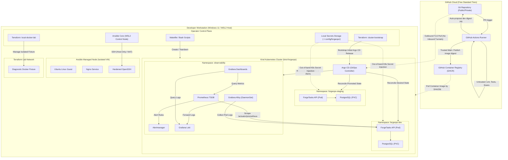

# System Architecture & Component Ownership — ForgeOps

**Document Version:** 1.0  
**Effective Date:** 2026-10-22  
**Baseline Gate:** G00 Architecture Review

---

## 1. High-Level System Architecture

The ForgeOps platform orchestrates a complete software delivery, platform engineering, and site reliability lifecycle locally on a Windows 11 / WSL2 workstation without paid cloud dependencies.

---

## 2. Resource Ownership Contract

To eliminate control-plane collisions and state corruption, every computing entity in ForgeOps is assigned exactly **one sole owner**:

| Resource | Sole Owner | Prohibited Overlapping Owner | Failure Mode Prevented |
|---|---|---|---|
| **Kind Cluster Nodes & Bridge** | Shell Lifecycle Script (`scripts/cluster/create.sh`) | Terraform Docker Provider / Docker prune | Cluster state deadlock, accidental node loss |
| **Local IaC Lab Network & Fixture**| Terraform `local-docker-lab` module | Docker Compose / Kind / Manual CLI | Drift collisions and accidental fixture deletion |
| **Linux Guest VM & Services** | Ansible Playbooks (`infrastructure/ansible/`) | Terraform `remote-exec` / Manual SSH | Inconsistent package states, broken idempotence |
| **Argo CD Bootstrap Release** | Terraform `cluster-bootstrap` module | Argo CD self-management before handoff | Cyclic bootstrap dependency deadlocks |
| **App & Observability Workloads** | Argo CD (rendering Helm charts) | Direct `helm upgrade` / Terraform K8s provider | OutOfSync fight between Helm and GitOps controller |
| **Database Schema Migrations** | Flyway (embedded in API startup) | Terraform / Helm destructive resets | Data corruption, unrecorded DDL migrations |
| **PostgreSQL Backup Files** | Host-side shell script (`make backup-db`) | Kubernetes PVC local provisioner | Data loss upon Kind cluster deletion |
| **Operator Secrets** | Out-of-band local injection script | Git repository / Terraform state / Helm values | Public credential leakage to GitHub |

---

## 3. Subsystem Boundaries & Responsibilities

### 3.1 Developer Workstation (Windows 11 / WSL2)
- **Host Role:** Provides physical hardware execution, virtualization via Hyper-V/WSL2, and Docker Desktop Linux engine.
- **Access Guard:** All exposed network ports (API, Grafana, Argo CD) bind exclusively to loopback (`127.0.0.1`). External incoming connections from the local LAN are dropped by default Windows firewall rules.

### 3.2 Kubernetes Runtime (Kind)
- **Engine:** Executes containerized Kubernetes nodes inside Docker Engine on WSL2.
- **Namespaces:**
  - `forgeops-dev`: Continuous deployment environment for ForgeTasks API. Reconciled automatically by Argo CD upon PR merge.
  - `forgeops-staging`: Promotion environment. Synchronized manually after validation in `dev`.
  - `observability`: Hosts Prometheus, Grafana, Alertmanager, Loki, and Grafana Alloy.
  - `argocd`: Hosts the GitOps control plane.

### 3.3 CI Supply Chain (GitHub Actions)
- **Untrusted PR Checks:** Runs in isolated Linux runners with read-only permissions. Executes static checks, unit/integration tests, Gitleaks, and Trivy scans.
- **Trusted Main Release:** Only runs on merged commits to `main`. Builds the multi-stage image, generates SBOM, and publishes an immutable `sha256:...` digest to GHCR.
- **No Direct Deployments:** GitHub Actions **never** initiates an inbound connection to the developer machine or Kind cluster.

### 3.4 Configuration Management Lab (Ansible + VM)
- **Control Node:** WSL2 Ubuntu running `ansible-core 2.17.7`.
- **Managed Node:** A dedicated local Ubuntu Linux virtual machine reachable exclusively over SSH on a host-only / private NAT network.
- **Operational Independence:** The Ansible lab executes independently of Kind, allowing host administration exercises without risking cluster workloads.
