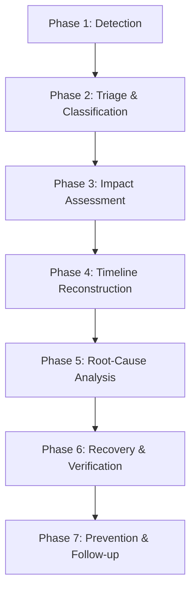

# ForgeOps Incident Response Master Runbook

## 1. Overview & Objectives

This runbook defines the canonical 7-phase incident management lifecycle for the ForgeOps platform. The goal is to minimize Mean Time To Detect (TTD) and Mean Time To Recover (TTR) while strictly protecting persistent state and database integrity.



---

## 2. The 7 Incident Response Phases

### Phase 1: Detection
- **Signals**:
  - Alertmanager firing alerts (`KubePodCrashLooping`, `HighRequestLatency`, `DeploymentRolloutFailed`).
  - k6 load test threshold violations (`http_req_failed > 0.05` or `p(95) > 1000ms`).
  - Grafana dashboard visual indicators (red status panels, spike in 5xx HTTP codes).
- **Initial Log**: Record discovery timestamp ($T_{\text{detect}}$) and source alert.

### Phase 2: Triage & Classification
- **Severity Matrix**:
  - **SEV-1 (Critical)**: Complete service outage, data corruption risk, or multiple pods unready with zero traffic served.
  - **SEV-2 (High)**: Degraded performance, single pod failure in multi-replica set, elevated p95 latency > 500ms.
  - **SEV-3 (Medium)**: Non-blocking warning, minor configuration drift, transient metric spike.
- **Incident Commander (IC)**: Assigned engineer leads mitigation and delegates investigation.

### Phase 3: Impact Assessment & State Protection Guard
- **Check Protected PVCs**:
  ```bash
  KUBECONFIG=/home/tharuka/.kube/config-forgeops kubectl get pvc -A
  ```
  Verify that all 5 protected PVCs (G06, G08, G09, G10, G11) are present and in `Bound` status.
- **Blast Radius**: Identify whether issue is isolated to a specific namespace (`forgeops-sre-lab`, `forgeops-gitops-rehearsal`, or `forgeops-dev`).

### Phase 4: Timeline Reconstruction
- **Log Correlation (Loki)**:
  Query logs in Grafana Explore or log streams:
  ```logql
  {namespace=~"forgeops.*"} |= "ERROR"
  ```
- **Trace Waterfall (Tempo)**:
  Locate spans by `trace_id` or query error traces (`status=error`).
- **Kubernetes Event Log**:
  ```bash
  kubectl get events -n <namespace> --sort-by='.metadata.creationTimestamp' | tail -n 20
  ```

### Phase 5: Root-Cause Analysis (RCA)
- Apply the **5 Whys** framework.
- Distinguish between application failure, configuration error, infrastructure constraint, or downstream database blockage.

### Phase 6: Recovery & Post-Recovery Verification
- **Remediation Actions**:
  - For failed rollout: `kubectl rollout undo deployment/<name> -n <namespace>`
  - For GitOps drift: `kubectl apply -k <manifest-path>` or trigger Argo CD sync.
  - For stuck pods: delete unready pod after verifying replica controller is active.
- **Health Verification**:
  ```bash
  curl -sf http://<host>:<port>/actuator/health/readiness | jq .
  ```
- **Protected State Verification**: Re-verify the 5 protected PVC UIDs.

### Phase 7: Prevention & Follow-up
- Update documentation and architectural decision records (ADRs).
- Add regression tests or tighten preflight validation gates.
- Archive incident summary in `docs/evidence/`.
