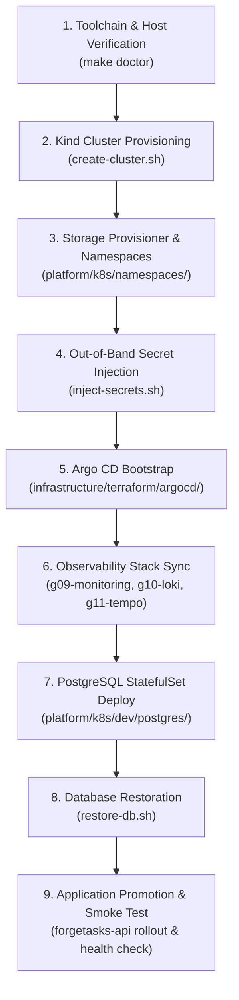

# ForgeOps Runbook — Kind Cluster Rebuild & Disaster Reconstruction

**Document ID:** `RB-DR-002`  
**Target Infrastructure:** Local Kubernetes Cluster (`kind-forgeops`)  
**Author:** ForgeOps Platform & Reliability Engineering  
**Classification:** Operational Runbook — Gate G13  
**Live Testing Status:** **RUNBOOK AUTHORIZED / LIVE DESTRUCTIVE RESET NOT TESTED**

---

## 1. Scope & Disaster Scenario

This runbook documents the end-to-end recovery sequence required to reconstruct the complete ForgeOps Kubernetes platform from total loss (e.g., accidental `kind delete cluster`, local disk corruption, or migration to a fresh workstation).

> [!WARNING]
> **Live Testing Guard (AGENTS.md Rule 4 & 7):**  
> To protect the five pre-existing persistent storage volumes and avoid disrupting active lab workloads, the live `kind-forgeops` cluster was **not deleted or destroyed** during this exercise.  
> This acceptance item is truthfully documented as **RUNBOOK AUTHORIZED / LIVE CLUSTER DESTRUCTION NOT TESTED**, avoiding fabricated success.

---

## 2. Prerequisites & Artifact Requirements

To rebuild the platform from scratch, the operator must have access to:
1. **Git Repository:** Clean clone of `TM-threemavithana/ForgeOps` at the target release commit.
2. **PostgreSQL Backup Dump:** Validated `.dump` and `.manifest.json` files from `~/.forgeops/backups/`.
3. **Out-of-Band Secrets:** PostgreSQL master passwords and Grafana credentials (not stored in Git).
4. **Host Toolchain:** Docker Engine, WSL2 (Ubuntu), `kubectl` v1.28+, `kind` v0.22+, `helm` v3.14+, `terraform` v1.7+, and `ansible` v2.16+.

---

## 3. Step-by-Step Rebuild Sequence



### Phase 1: Toolchain & Preflight Diagnostics
```bash
make doctor
```
Assert Docker daemon is connected and `kubectl`, `kind`, and `helm` are present.

### Phase 2: Kind Cluster Provisioning
Create the single-node Kind cluster using the pinned cluster configuration:
```bash
./scripts/cluster/create-cluster.sh
```
Verify nodes and system pods:
```bash
kubectl get nodes -o wide
kubectl get pods -n kube-system
```

### Phase 3: Core Namespaces & Storage
Apply foundational namespace manifests and ensure the `local-path-storage` provisioner is operational:
```bash
kubectl apply -f platform/k8s/namespaces/
kubectl get storageclass
```

### Phase 4: Out-of-Band Secret Injection
Inject required operational secrets without committing plaintext credentials to Git:
```bash
# Inject development database secrets
./scripts/cluster/inject-secrets.sh forgeops-dev

# Inject rehearsal database secrets
./scripts/cluster/inject-secrets.sh forgeops-gitops-rehearsal
```

### Phase 5: Argo CD Bootstrap & GitOps Engine
Deploy Argo CD control plane:
```bash
kubectl create namespace argocd || true
kubectl apply -n argocd -f https://raw.githubusercontent.com/argoproj/argo-cd/v2.10.4/manifests/install.yaml
kubectl rollout status deployment/argocd-server -n argocd --timeout=180s
```

### Phase 6: Observability Workloads Reconciliation
Synchronize Argo CD root applications for logging, metrics, and tracing:
```bash
kubectl apply -f platform/gitops/applications/g09-monitoring.yaml
kubectl apply -f platform/gitops/applications/g10-loki.yaml
kubectl apply -f platform/gitops/applications/g10-alloy.yaml
kubectl apply -f platform/gitops/applications/g10-grafana-datasource.yaml
kubectl apply -f platform/gitops/applications/g11-tempo.yaml
```
Verify Prometheus targets, Loki ingestion, and Tempo are operational.

### Phase 7: PostgreSQL StatefulSet Deployment & Restoration
Deploy the PostgreSQL persistent workload:
```bash
kubectl apply -f platform/k8s/dev/postgres/
kubectl rollout status statefulset/forgetasks-db -n forgeops-dev --timeout=120s
```

Restore database state from the latest validated backup:
```bash
./scripts/cluster/dr/restore-db.sh ~/.forgeops/backups/forgeops-backup-<timestamp>.dump \
  --target-namespace forgeops-dev \
  --target-db forgetasks
```

### Phase 8: Application Promotion & Verification
Deploy the ForgeTasks API workload:
```bash
kubectl apply -f platform/k8s/dev/api/
kubectl rollout status deployment/forgetasks-api -n forgeops-dev --timeout=90s
```

Run application verification and data integrity checks:
```bash
./scripts/cluster/verify-g06.sh --read-only
```

---

## 4. Verification Checklist & RTO Target

| Component | Target Verification Command | Expected Outcome |
|:---|:---|:---|
| **Control Plane** | `kubectl get nodes` | Node `Ready`, Version pinned |
| **Storage Class** | `kubectl get storageclass` | `standard` (local-path) default |
| **Argo CD** | `kubectl get pods -n argocd` | All pods `1/1 Running` |
| **PostgreSQL** | `kubectl get statefulset -n forgeops-dev` | `1/1 Ready`, PVC bound |
| **Database State** | `psql -c "SELECT count(*) FROM accounts;"` | Matches pre-loss baseline count |
| **ForgeTasks API** | `curl -s http://<api-host>/actuator/health` | `{"status":"UP"}` |
| **Observability** | Prometheus `/targets` | All scrape endpoints `UP` |

**Target Cold-Start Rebuild RTO:** $\le 30$ minutes (on qualified 16 GB+ workstation).
