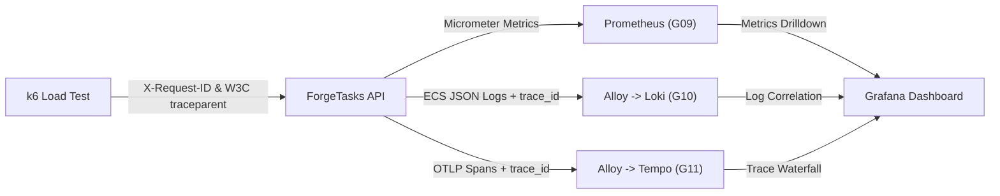

# ForgeOps Gate G12: SRE SLI / SLO Specification and Error Budget Framework

## 1. Executive Summary & Lab Scope Boundary

This document establishes the Service Level Indicators (SLIs), Service Level Objectives (SLOs), and Error Budget accounting framework for the ForgeOps platform.

> [!IMPORTANT]
> **Lab Environment Disclaimer**: ForgeOps runs locally on a single-node Kind Kubernetes cluster on a developer workstation. The SLIs and SLOs defined herein are **illustrative engineering targets** designed for reliability testing, chaos rehearsal, and performance baselining. They do not constitute commercial multi-region cloud SLAs.

---

## 2. Core Service Level Indicators (SLIs)

### 2.1 Availability SLI (HTTP Success Rate)

The ratio of successful HTTP requests (non-5xx status codes) to total HTTP requests received by the ForgeTasks API.

- **Formula**:
  $$\text{SLI}_{\text{avail}} = \frac{\sum \text{Rate}(\text{http\_server\_requests\_seconds\_count}\{\text{status} ! \sim \text{"5.."}\})}{\sum \text{Rate}(\text{http\_server\_requests\_seconds\_count})}$$
- **PromQL Query**:
  ```promql
  sum(rate(http_server_requests_seconds_count{status!~"5.."}[5m]))
  /
  sum(rate(http_server_requests_seconds_count[5m]))
  ```
- **Illustrative Lab SLO Target**: **99.0%** over a test execution window.

---

### 2.2 Latency SLI (p95 and p99 Response Time)

The duration in milliseconds for the API to process and respond to an HTTP request, evaluated across the 95th and 99th percentiles of the request distribution.

- **Formula**:
  $$\text{SLI}_{\text{latency}} = \text{Percentile}_{95}(\text{request duration}) \le 250\text{ms}$$
- **PromQL Queries**:
  - **p95 Latency**:
    ```promql
    histogram_quantile(0.95, sum(rate(http_server_requests_seconds_bucket{uri!~"/actuator.*"}[5m])) by (le))
    ```
  - **p99 Latency**:
    ```promql
    histogram_quantile(0.99, sum(rate(http_server_requests_seconds_bucket{uri!~"/actuator.*"}[5m])) by (le))
    ```
- **Illustrative Lab SLO Target**:
  - **p95**: $\le 250\text{ms}$ under standard baseline concurrency (5 VUs).
  - **p99**: $\le 500\text{ms}$ under standard baseline concurrency.

---

### 2.3 Recovery SLI (Mean Time To Recover - MTTR)

The time elapsed from the initiation/detection of an abrupt failure to the full restoration of healthy, traffic-ready replicas.

- **Component Targets**:
  - **Single Pod Termination Self-Healing**: $\text{MTTR} \le 60\text{s}$ (Deployment controller rescheduling and spring boot readiness).
  - **Failed Image Rollback**: $\text{MTTR} \le 120\text{s}$ (Rollout undo and container stabilization).
  - **Declarative GitOps Reconciliation**: $\text{MTTR} \le 90\text{s}$ (Sync and desired state alignment).

---

## 3. Error Budget Accounting

### 3.1 Mathematical Definition

The Error Budget represents the acceptable amount of unreliability permitted over a given evaluation window:

$$\text{Error Budget} = 1.0 - \text{SLO}_{\text{target}}$$

$$\text{Allowed Errors} = \text{Total Requests} \times \text{Error Budget}$$

### 3.2 Illustrative Scenarios

| Scenario | Total Requests | SLO Target | Error Budget | Allowed Failed Requests |
| :--- | :--- | :--- | :--- | :--- |
| **k6 Smoke Test** | 500 | 99.0% | 1.0% | 5 |
| **k6 Baseline Load** | 3,000 | 99.0% | 1.0% | 30 |
| **k6 Ramp-Up Test** | 6,000 | 99.0% | 1.0% | 60 |
| **Chaos Pod Kill** | 1,000 (concurrent) | 98.0% | 2.0% | 20 |

### 3.3 Burn Rate & Governance Policy

- **Burn Rate**: The rate at which the error budget is consumed relative to normal operation.
  $$\text{Burn Rate} = \frac{\text{Observed Error Rate}}{1.0 - \text{SLO}}$$
- **Operational Rules**:
  - **Burn Rate $\le 1.0$**: Steady-state operation; routine deployments permitted.
  - **Burn Rate $1.0 < \text{BR} \le 5.0$**: Warning state; SRE investigation recommended.
  - **Burn Rate $> 5.0$ or Budget Depleted**: Immediate deployment freeze; initiate Incident Response runbook.

---

## 4. Full-Stack Observability Correlation

To diagnose and resolve incidents rapidly, all components are correlated across metrics, logs, and traces:



1. **Request Identification**: Incoming requests carry `X-Request-ID` and standard W3C `traceparent` headers (`00-${traceId}-${spanId}-01`).
2. **Log Correlation**: Spring Boot logs in ECS JSON format, embedding `trace_id` and `span_id`. Loki queries filter by `app="forgetasks-api"` and trace ID.
3. **Trace Waterfall**: Grafana Tempo visualizes internal spans (controller dispatch, service layer, repository operations, HikariCP pool).
4. **Metrics Correlation**: Prometheus captures requests, latencies, and JVM heap saturation.

---

## 5. Architectural Limitations & Reliability Testing Boundaries

### 5.1 Port-Forward Single-Pod Routing Limitation
When executing load tests via `kubectl port-forward svc/sre-api 8082:8080`, the Kubernetes API server and client tunnel traffic to a **single backend Pod** selected upon connection establishment. 
- **Honest SRE Assessment**: Load generated through localhost port-forwarding does not test multi-replica round-robin distribution via kube-proxy. Instead, it measures **single-instance saturation, thread-pool contention, and individual pod resilience** under progressive concurrency.
- Multi-replica failover is validated independently in Experiment 01 (pod kill and self-healing) and Experiment 02 (readiness probe traffic exclusion).

### 5.2 Strict Arrival-Rate Ceiling & Concurrency Cap
To safeguard the local developer workstation and Kind cgroups against resource starvation:
- Aggregate traffic across all scenarios is **hard-capped at 20 requests/second**.
- Concurrency is **bounded at a maximum of 25 Virtual Users (VUs)**.
- Scenarios enforce rate limits using k6 `constant-arrival-rate` and `ramping-arrival-rate` executors, backed by `abortOnFail: true` safety thresholds.

### 5.3 Declarative Reconciliation vs. Argo CD GitOps Controllers
- Experiment 05 demonstrates **Kubernetes declarative reconciliation** (`kubectl apply -k`), proving that the declared Git source-of-truth automatically converges over imperative runtime drift.
- While Argo CD implements this same declarative convergence pattern continuously via its GitOps reconciliation loop, this experiment is isolated to `forgeops-sre-lab` to guarantee zero interference with existing protected GitOps Applications (`forgetasks-rehearsal`, `monitoring`, `logging`, `tempo`).

### 5.4 Ephemeral Database Credentials & Isolation
- Database passwords for `forgeops-sre-lab` are generated dynamically at deployment time via `openssl rand -hex 16` and injected into ephemeral Secrets.
- No database credentials are hardcoded or shared outside the disposable namespace.
- Ephemeral PostgreSQL runs entirely on `emptyDir: {}` memory/disk scratch storage, ensuring zero new PersistentVolumeClaims.
